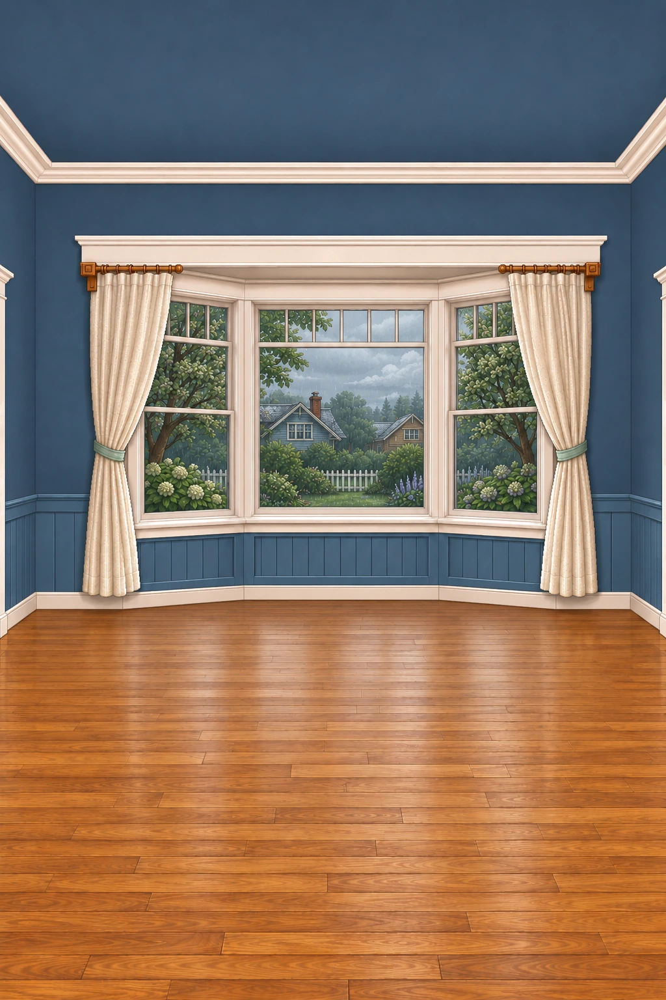
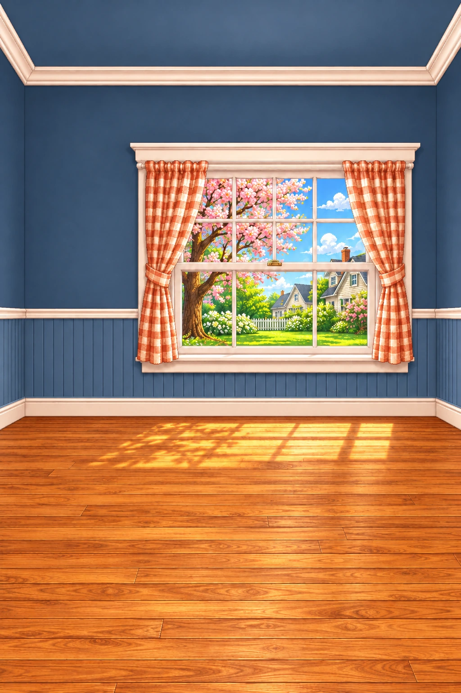

<p align="center">
  
</p>

<h1 align="center">MOCHI</h1>
<p align="center"><strong>Маленький дом. Большая любовь.</strong></p>
<p align="center">Уютная игра о питомце: забота, обустройство комнаты и маленькие повседневные радости.</p>

**Версия 9.0.0 · React + TypeScript · браузер · подготовка к Telegram Mini App**

MOCHI — виртуальный питомец, которого можно кормить, укладывать спать, развлекать и наряжать. Здесь есть полноценное первое знакомство, две комнаты, магазин, мини-игры, погода за окном и индивидуальные голоса персонажей. Дополнительно доступны локальный сервер общего дома и виджет для главного экрана iPhone через Scriptable.

Проект находится в стадии работающего прототипа. Браузерная игра, LAN-сервер и установочный файл виджета реализованы. Публичный сервер с проверкой Telegram-аккаунтов пока не подключён.

[Возможности](#возможности) · [Питомцы](#питомцы) · [Запуск](#запуск) · [Общий дом](#общий-дом) · [Виджет iPhone](#виджет-iphone) · [Telegram](#telegram-mini-app) · [Разработка](#разработка)

## Возможности

| Раздел | Что есть в версии 9 |
| --- | --- |
| Первое знакомство | Звонок, дверь, посылка, записка, коробка и руки, поднимающие питомца. Вступление можно пересмотреть без сброса прогресса. |
| Забота | Еда, сон, игры и ласка; потребности меняются со временем, в том числе после закрытия игры. |
| Питомцы | 7 персонажей, выбор имени, смена друга с сохранением вещей, валюты и роста. |
| Дом | Гостиная и спальня, отдельные предметы мебели, установка и перенос между комнатами. |
| Магазин | 70 предметов: 16 продуктов, 43 предмета обстановки, 11 аксессуаров. Категории, редкость и сортировка. |
| Атмосфера | День, закат и ночь; ясная погода, облака, дождь и снег; автоматическая погода Алматы по желанию. |
| Свет | Тёплые настольные лампы, плавное включение, анимированная лава в четырёх палитрах, дополнительный WebGL2-шейдер освещения. |
| Звук | 42 индивидуальных голосовых клипа питомцев и 10 звуков действий и атмосферы. |
| Мини-игры | Четыре игры с наградами в игровой валюте. |
| Прогресс | Четыре стадии роста, 50 достижений, дневник и разные финалы. |
| Сохранение | Автосохранение в браузере и миграция поддерживаемых старых сохранений. |
| Совместная игра | Один питомец, общий инвентарь, монеты и обстановка через Node.js-сервер в локальной сети. |
| iPhone | Маленький и средний виджеты Scriptable: питомец, потребности или оба варианта. |
| Интерфейс | Русский язык, локальный Noto Sans с кириллицей, ретро-значки, адаптивная вёрстка, безопасные отступы и уменьшение анимаций. |

## Питомцы

| | Друг | Характер и голос | ID |
| --- | --- | --- | --- |
|  | **Максвелл** | Чёрно-белый кот; мягкое мяуканье. | `cat` |
|  | **Кролик Луна** | Кремовый кролик; тихое урчание и сопение. | `rabbit` |
|  | **Такса Пончик** | Длинное тело, короткие лапы; звонкое гавканье. | `dog` |
|  | **Хомячок Пико** | Пушистый хомяк; маленькие писки. | `hamster` |
|  | **Пушин** | Серый кот; низкое мультяшное мурчание. | `pusheen` |
|  | **Капибара Капи** | Спокойная капибара; свист и бормотание. | `capybara` |
|  | **Чимс** | Золотистый сиба-ину; хрипловатый голос. | `cheems` |

У каждого друга свой темп дыхания и моргания, три варианта поведения в покое и реакции на еду, игру, ласку и пробуждение. Питомцы потягиваются, принюхиваются, подпрыгивают, покачиваются и закрывают глаза во сне. Используются 13 вариантов движения; голос меняется по настроению, для каждого настроения есть два клипа. Голоса синтезированы для игры, это стилизованные звуки, а не записи настоящих животных.

Аксессуары подогнаны по индивидуальным точкам каждого персонажа. Над головой оставлено прозрачное пространство для шляп: тело и лапы сохраняют свой размер и положение. Изображения вещей в каталоге и на питомце создаются одним кодом.

## Комнаты, мебель и атмосфера

<p>
  
  
</p>

*Фоны двух комнат. Покупаемая мебель, питомец, интерфейс, погода и свет добавляются отдельными слоями.*

Гостиная и спальня оформлены в спокойных синих тонах: большие окна, светлые рамы, шторы и дубовый пол. В магазине есть диваны, кресла, кровати, столики, ковры, растения, картины, светильники и декор.

- Мебель размещается **по подготовленным местам**. Свободного перетаскивания в любую точку комнаты пока нет.
- Один купленный предмет можно перенести из одной комнаты в другую или убрать в инвентарь. Одна вещь не появляется одновременно в двух комнатах.
- Настольным предметам нужен столик. При переносе столика зависимый декор возвращается в инвентарь.
- Обычная и лавовая лампы могут стоять рядом. Внутри лавовой лампы движется воск, обычный свет включается плавно; установленные настольные лампы загораются ночью и во время сна.
- Дождь и снег ограничены масками оконных стёкол. При смене погоды меняются внешний пейзаж и его освещение, осадки не попадают на питомца и мебель.
- Основная сцена работает без WebGL. Шейдер добавляет освещение на поддерживаемых устройствах; без него комната и обычные световые эффекты остаются видны.

Время суток можно выбирать вручную или связывать с часами. Ручная погода работает офлайн. Автоматическая погода получает прогноз и температуру **Алматы** через [Open-Meteo](https://open-meteo.com/), без запроса геолокации пользователя. При ошибке сети сохраняется последняя атмосфера. Выбора других городов пока нет.

## Уход, магазин и прогресс

Три компактных показателя — еда, сон и игры — находятся внутри экрана комнаты. Там же доступны кормление, игра, сон и ласка. Нельзя потратить последнюю порцию дважды; сытый или спящий питомец не принимает еду. Сон восстанавливает энергию по прошедшему времени.

**Еда:** яблоко, груша, клубника, банан, арбуз, вишня, персик, круассан, панкейки, суши, печенье, молоко, пончик, апельсин, морковь и миска с лососем. У продуктов отдельные рисунки, цены и питательность; купленные порции расходуются при кормлении.

**Аксессуары:** бантик, шарф, шапка, корона, наушники, солнцезащитные очки, шапка-лягушка, росток, колпак волшебника, шапка-утка и тост. Все 11 образов доступны всем семи питомцам. Конкретные цены и слоты хранятся в [каталоге](shared/catalog.mjs).

Игровую валюту можно получать в мини-играх и за достижения. Покупки, цены, ограничения действий и награды определены в общей модели клиента и сервера. XP и рост отображаются в дневнике. Пороговые значения четырёх стадий: **0, 100, 300 и 700 XP**; особая форма дополнительно зависит от ухода.

Дневник хранит события жизни питомца. В игре 50 достижений с однократными наградами. Сохранены правила исходного проекта: длительный голод останавливает рост; семь дней без еды и две недели в особой форме приводят к разным финалам. Перед сбросом истории интерфейс запрашивает подтверждение.

### Мини-игры

| Игра | Задача |
| --- | --- |
| Облачный прыжок | Подниматься по платформам. |
| Пиксельный отскок | Поддерживать мяч в игре. |
| Фруктовый дождь | Ловить падающие фрукты. |
| Найди пару | Открывать одинаковые карточки. |

### Звук и доступность

Звуки действий, голоса и атмосфера включены в проект; загрузки с внешних аудиосервисов нет. Громкость и фон регулируются в настройках. На iPhone звук разблокируется первым касанием; громкость устройства и ограничения браузера также влияют на воспроизведение. При выключении звука, смене питомца и скрытии страницы незавершённые голосовые запросы отменяются.

Интерфейс использует встроенный Noto Sans с кириллицей. Есть видимые состояния фокуса, обработка закрытия диалогов, настройки анимаций и поддержка системного `prefers-reduced-motion`. Подготовлены варианты вёрстки для узких телефонов и невысоких альбомных экранов. Полная проверка на физических устройствах ещё требуется.

## Запуск

Нужен **Node.js 22 или новее**. Исходники не требуют ключей API.

### Разработка

Скачайте репозиторий через **Code → Download ZIP**, распакуйте и откройте терминал в его папке:

```bash
npm ci
npm run dev
```

Откройте адрес, который напечатает Vite, обычно `http://localhost:5173`. Этот режим запускает фронтенд; API общего дома появляется при запуске Node.js-сервера ниже.

### Игра и сервер общего дома

```bash
npm ci
npm run build
npm start
```

Откройте **http://localhost:3000**. Сервер раздаёт собранный фронтенд и `/api/*` с одного адреса. Папка `dist` создаётся сборкой и не хранится в Git. После её создания сам сервер может работать без npm-зависимостей: он использует встроенные модули Node.js.

### Один HTML-файл

```bash
npm ci
npm run standalone
```

Появится **`MOCHI-play.html`** со встроенными изображениями, звуками, шрифтами и файлами виджета. Откройте его в браузере; на Windows после сборки можно использовать `START_WINDOWS.bat`. Во время игры Node.js и npm не нужны.

Сохраняйте один браузер и путь к файлу для доступа к своему локальному сохранению. Настоящая погода требует интернета, общий дом — запущенного сервера. Автономный HTML не загружает Telegram SDK. На iPhone открытие HTML в приложении «Файлы» не заменяет размещённую HTTPS-версию в Safari или Telegram.

## Общий дом

Общий дом объединяет состояние питомца, покупки, инвентарь и комнаты. Это **локальный прототип совместной игры по коду дома**: привязки к двум конкретным Telegram-аккаунтам и ограничения количества участников пока нет.

1. Соберите проект: `npm ci`, затем `npm run build`.
2. На Windows запустите `START_SHARED_WINDOWS.bat`: он включает доступ из локальной сети и печатает адреса компьютера.
3. На компьютере откройте игру и в меню выберите «Общий дом». Укажите имя участника и создайте дом.
4. На втором устройстве в той же сети откройте напечатанный адрес `http://IP_КОМПЬЮТЕРА:3000`, выберите «Общий дом» и введите код.

**Создание общего дома начинает новую совместную игру.** Локальные монеты и покупки не импортируются. Интерфейс предупреждает об этом до замены текущего прогресса.

Для ручного запуска в LAN:

```bash
# macOS / Linux
MOCHI_HOST=0.0.0.0 npm start
```

```powershell
# Windows PowerShell
$env:MOCHI_HOST = "0.0.0.0"
npm start
```

| Переменная | Значение по умолчанию | Назначение |
| --- | --- | --- |
| `MOCHI_HOST` | `127.0.0.1` | `0.0.0.0` открывает сервер для других устройств. |
| `MOCHI_PORT` | `3000` | Порт; также поддерживается `PORT`, если `MOCHI_PORT` не задан. |
| `MOCHI_DATA_DIR` | `.mochi-data` рядом с сервером | Каталог постоянного хранения домов. |

Состояние обновляется опросом примерно раз в три секунды. Сервер проверяет действия, защищает повторные запросы от двойного применения и возвращает конфликт версий при одновременном изменении. Дома сохраняются в `.mochi-data/houses.json`; папку нужно переносить и резервировать отдельно. Доступ к дому даёт его код.

Перед публичным запуском нужны проверка Telegram `initData`, сессии и членство участников, ограничения частоты запросов, проверка результатов игр и транзакционная база. Текущий JSON рассчитан на один процесс сервера. Подробности и таблица API — в [docs/INTEGRATION.md](docs/INTEGRATION.md).

## Виджет iPhone

В проект входит **виджет главного экрана через [Scriptable](https://apps.apple.com/ru/app/scriptable/id1405459188)**. Собственного приложения из App Store или нативного расширения WidgetKit в репозитории нет.

1. Установите Scriptable на iPhone.
2. Скачайте [MOCHI.scriptable](public/widgets/MOCHI.scriptable) через кнопку **Download raw file** на странице файла. В «Файлах» выберите «Поделиться» → Scriptable и импортируйте MOCHI.
3. Запустите скрипт и выберите питомца.
4. Добавьте на главный экран маленький или средний виджет **Scriptable**. В его настройках выберите скрипт **MOCHI**.

| Режим | Содержимое |
| --- | --- |
| `pet` | Крупный питомец; работает сразу и без сети. |
| `needs` | Еда, сон и игры. |
| `both` | Питомец и потребности; рассчитан на средний виджет. |

Все семь питомцев и их спящие портреты включены в установочный файл. Для передачи реального имени, аксессуара и показателей откройте в игре **«Настройки → Виджет на iPhone → Передать потребности»**, затем импортируйте данные в MOCHI внутри Scriptable.

**Синхронизация пока ручная.** После действий в игре данные нужно передать повторно. Между передачами виджет использует прогноз на 48 часов из тех же игровых правил; после истечения срока показывает прочерки и просит обновление. Без импорта проценты не придумываются. iOS сама определяет время обновления; постоянной анимации и звука в виджете нет.

Инструкция, альтернативный импорт `.js`, параметры и ограничения — в [phone-widget/README_RU.md](phone-widget/README_RU.md). При переносе игры на другой домен замените `GAME_URL` в [phone-widget/src/main.mjs](phone-widget/src/main.mjs), затем выполните `npm run widget` и пересоберите игру. Текущая ссылка открытия ведёт на исходный предпросмотр и может требовать доступ владельца.

## Telegram Mini App

Клиент подключает Telegram WebApp SDK: `ready`, `expand`, безопасные отступы, кнопку «Назад» и тактильный отклик. Это готовность интерфейса к запуску внутри Telegram; серверной авторизации Telegram пока нет.

Для подключения своего бота:

1. Разместите сборку на доступном **HTTPS-адресе**.
2. В [BotFather](https://t.me/BotFather) настройте кнопку меню Mini App на этот адрес.
3. Для общего питомца запустите Node.js-сервер на постоянном хостинге, подключите устойчивое хранение и проверку Telegram-пользователей.
4. Проверьте игру внутри Telegram на реальных телефонах.

Публикация исходников на GitHub не запускает сервер. GitHub Pages раздаёт только статические файлы и не выполняет `server.mjs`. У проекта есть абсолютные пути к ресурсам: размещение в подпапке `/<repository>/` требует отдельной настройки путей. Публичного рабочего демо с общей игрой эта публикация не создаёт.

Токен бота фронтенду не нужен. Инструкции: [Telegram](docs/TELEGRAM.md) и [размещение](docs/DEPLOYMENT.md).

## Разработка

### Команды

| Команда | Действие |
| --- | --- |
| `npm ci` | Установить зависимости по lock-файлу. |
| `npm run dev` | Запустить Vite для разработки интерфейса. |
| `npm run check` | Проверить TypeScript. |
| `npm test` | Запустить 43 автоматические проверки. |
| `npm run build` | Проверить типы и собрать production-файлы в `dist`. |
| `npm start` | Раздать `dist` и запустить локальный API общего дома. |
| `npm run standalone` | Создать автономный `MOCHI-play.html`. |
| `npm run widget` | Пересобрать `.js` и `.scriptable` для iPhone. |

Проверки покрывают правила ухода, каталог, покупки, награды, миграции, размещение, маски осадков, синхронизацию и перезапуск сервера, голоса, отмену аудио и экспорт данных виджета. Готовый скрипт виджета выполняется в тестах с моделями API Scriptable для семи питомцев в двух размерах.

Это не заменяет проверку на физическом iPhone, в настоящем Telegram и на мобильном WebGL. Такая проверка ещё не завершена; стабильность на всех устройствах не заявляется.

### Структура

| Путь | Назначение |
| --- | --- |
| `src/App.tsx` | Экраны, магазин, настройки, дневник. |
| `src/Prologue.tsx` | Первое знакомство. |
| `src/Scene.tsx`, `src/room.css` | Слои комнаты, мебель и атмосфера. |
| `src/LightingShader.tsx`, `src/LavaLamp.tsx` | Дополнительное освещение и лава-лампы. |
| `src/art.ts`, `src/accessories.ts` | Подготовка персонажей и одежды. |
| `src/audio.ts`, `shared/companion-behavior.mjs` | Звук и индивидуальные реакции. |
| `src/Games.tsx` | Четыре мини-игры. |
| `src/useGameStore.ts` | Локальное сохранение и клиент общего дома. |
| `shared/game.mjs` | Единые игровые правила для клиента и сервера. |
| `shared/catalog.mjs`, `shared/companions.mjs` | Каталог и семь питомцев. |
| `shared/pet-rigs.mjs`, `shared/scene-geometry.mjs` | Посадка аксессуаров, слоты мебели, окна и свет. |
| `server.mjs` | HTTP-сервер, API и сохранение домов. |
| `phone-widget/`, `shared/widget.mjs` | Scriptable и прогноз потребностей. |
| `public/` | Поставляемые рисунки, аудио, шрифты и готовый виджет. |
| `scripts/`, `tests/`, `docs/` | Сборка ресурсов, проверки и документация. |

Графика и звуки уже включены. Для обычной сборки не нужны генераторы изображений, Python или платные сервисы. Скрипты Python предназначены для повторной подготовки отдельных ресурсов; их инструменты описаны в [docs/ASSETS.md](docs/ASSETS.md).

## Следующие этапы

- [ ] Публичный HTTPS-сервер с постоянным хранилищем.
- [ ] Проверка `initData`, Telegram-сессии и приглашение второго участника.
- [ ] Серверная проверка игровых результатов и ограничения запросов.
- [ ] Автоматическое обновление виджета через защищённый сервер.
- [ ] Проверка на физических iPhone и Android внутри Telegram.

Платежи, Telegram-напоминания и собственное нативное приложение в текущую версию не входят.

## Лицензирование и ресурсы

**Лицензия на исходники проекта пока не выбрана.** Открытая публикация не объявляет весь проект свободно лицензированным. Перед повторным использованием и распространением нужно уточнить права на код и конкретные ресурсы.

Растровая графика подготовлена с помощью генератора изображений, часть иконок и аксессуаров нарисована программно. Звуки синтезированы локально. В игре присутствуют образы известных мемных персонажей, в том числе Pusheen, Maxwell и Cheems; проект не заявляет права на исходных персонажей и не связан с их правообладателями.

Шрифты Noto Sans и производный ресурс Mochi Pixel сопровождаются [SIL Open Font License](public/fonts/OFL.txt). Сторонние npm-пакеты сохраняют собственные лицензии. Сведения о ресурсах — в [docs/ASSETS.md](docs/ASSETS.md).
